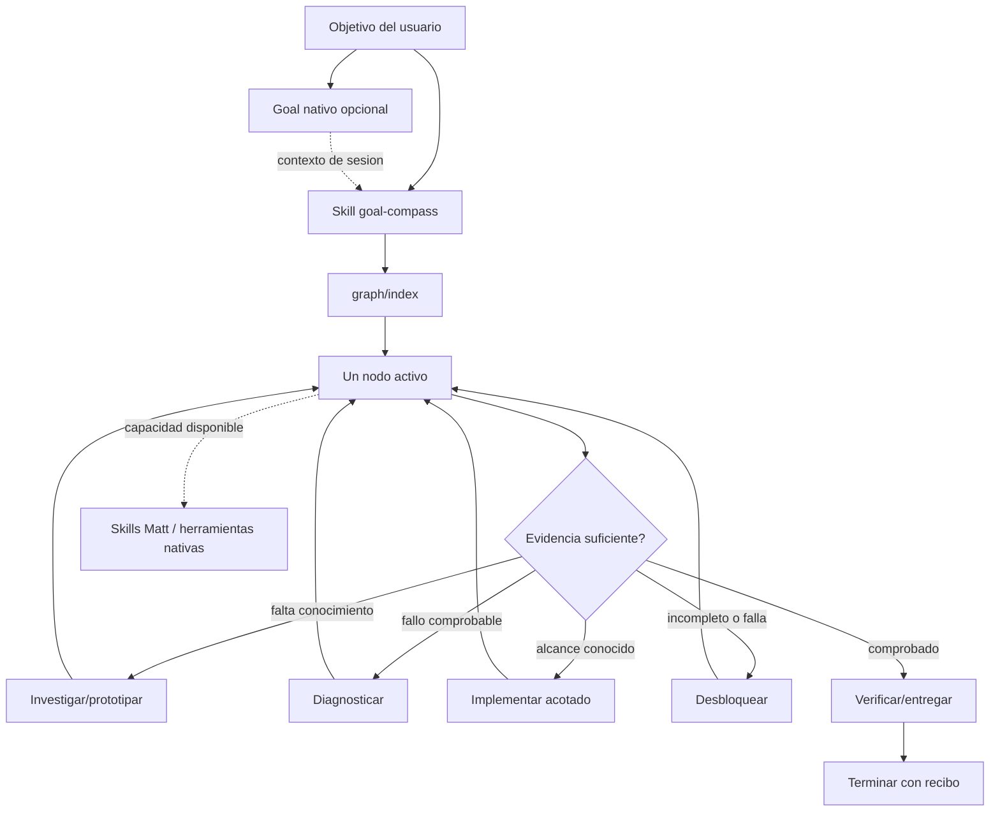

# Arquitectura · hipermedia local, no motor de workflows

## Componentes (primero lo mínimo)

1. `SKILL.md`: entrypoint y contrato de respuesta, siempre ligero; sabe abrir `graph/index.md`.
2. `graph/index.md`: home documental, rutas iniciales y enlaces, no recita las instrucciones de todos los nodos.
3. `graph/nodes/*.md`: cada recurso describe situación, preguntas, acción, prueba de salida y affordances.
4. `matt-adapters.md` (en specs): catálogo de capacidades externas; **no** incluyen código ni copias de skills.
5. MCode ejecuta comandos, skills y Goal por sus mecanismos normales. Goal Compass no intercepta APIs ni mantiene duplicados.

## Arquitectura conceptual

## Ontología pequeña (evita enums inflados)

- **Goal**: intención y criterio de éxito autorizado por usuario; propiedad de MCode si se usa `/goal`.
- **Situation**: observación actual; no es plan.
- **Evidence**: hecho contrastable con origen (archivo/línea, comando/salida, fuente documental); distingue observación, inferencia e hipótesis.
- **Blocker**: impedimento concreto con causa aparente e información que falta.
- **Probe**: acción mínima cuyo resultado cambia al menos una decisión.
- **Node**: contenido hipermedia con instrucciones y affordances.
- **Affordance**: enlace navegable con relación, precondición en lenguaje natural y resultado esperado.
- **Capability**: skill/herramienta existente cuya disponibilidad se descubre, no se asume.
- **Receipt**: prueba o límite de cierre, sin afirmar éxito solo por ejecución del prompt.

## Principios de composición

- **Una decisión, una prueba, un próximo enlace**. Priorizar obtener información de alto valor frente a producir documentos.
- **Lógica pura conceptual**: `route(goal, situation, evidence, previousAttempts) -> CandidateActions`. En v0.1 la ejecuta el razonamiento del agente; futuras versiones pueden ofrecer un evaluador puro, sin mezclarlo con shell/git.
- **Imperative shell at edges**: commands para obtener evidencia, siempre previa evaluación de permisos. La Skill decide, pero no es dueño de Git, MCode, editor, ni tokens.
- **No orquestación oculta**: para user-invoked skills de Matt, proponer llamada explícita al usuario; model-invoked solo si MCode expone la activación.
- **Estado mínimo**: ficha de 4-6 líneas en conversación en cada decisión. Handoff a ubicación externa únicamente cuando la sesión cambie o el usuario lo pida. Nada bajo `.scratch` o `docs` automáticamente.

## Grado de HATEOAS

Lo implementado **sí** ofrece navegación autodirigida por recursos y relaciones; **no** implementa HTTP, media types ni generación dinámica de enlaces basada en autorización. Las condiciones se evalúan en el consumidor (modelo). El roadmap deja una puerta opcional a `GET /node/{id}` con affordances materializadas si aparece necesidad real, sin construirlo preventivamente.

## Trazabilidad

- PRD F01..F12 en `01-producto.md`; interfaz en `03-contratos.md`.
- ADR-001/002/003/004 en `adr/`.
- Los ejemplos de nodos bajo `plugin/skills/goal-compass/graph/nodes/` son la referencia ejecutable, no duplicar el grafo en docs.
