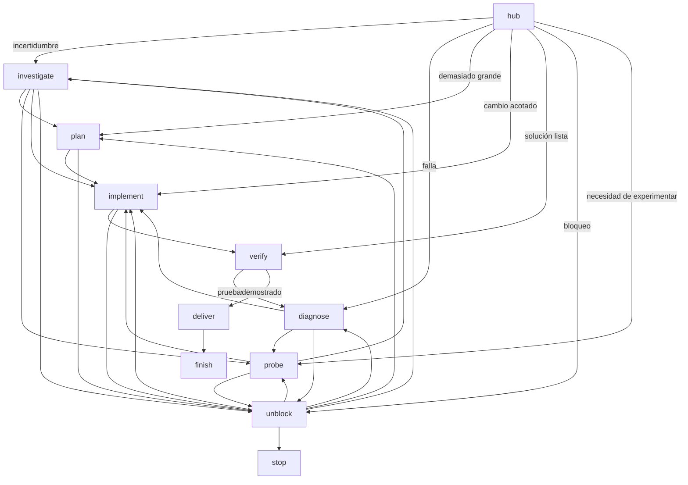

# Mapa de navegación y desbloqueos

## Rutas ejemplares

- `Fix con error reproducible`: `hub → diagnose → implement → verify → deliver → finish`.
- `Fallo difuso sin señal`: `hub → diagnose → probe → diagnose` (si hay señal), o `unblock`.
- `Miedo a cambiar API`: `hub → investigate → probe → plan/implement`.
- `Evolutivo grande`: `hub → plan → implement → verify → deliver` por hitos pequeños, nunca fabricar 40 tickets por defecto.
- `Tests explosivos`: `hub → investigate (coste de tests) → plan (poda) → implement (sustitución mínima) → verify`.
- `Dependencia humana/credencial`: `hub → unblock → stop/escalate` con la pregunta exacta y el trabajo reversible restante.
- `Investigación sin código`: `hub → investigate → finish` con fuentes y una decisión, no obligar a implementar.

## Modelo de bloqueos / desbloqueo lateral

| Síntoma | Hipótesis alternativa | Acción discriminante | Ruta |
|---|---|---|---|
| No sé qué hace API | Documentación deriva de código | Leer firma real y un call site | investigate |
| Test rojo opaco | El harness introduce el fallo | Ejecutar función/CLI directamente | probe |
| No hay relaciones de grafo | Falta cobertura, no hay arquitectura inferible | Medir relaciones por tipo de archivo | investigate / stop |
| Entrega detenida por gate | Error mecánico simple | Reparar solo puerta de entrada y rerun puntual | diagnose / verify |
| Cambiar módulo implica cascada | Seams mal ubicados | Prototipo sobre interfaz estrecha | probe / plan |
| Sin credencial | Hace falta intervención autorizada | Preguntar solo el secreto/permiso NO pedir exponer token | stop |
| No existe skill esperada | Adaptador incompleto | Continuar con prompt local acotado | implement / diagnose |
| Bucle de hipótesis | Ninguna acción cambia evidencia | Reformular pregunta falsable o escalar | unblock / stop |

## Preferencias de coste (no garantías)

1. Leer código/fuente existente antes que generar docs.
2. Usar comando de reproducción antes que un E2E nuevo.
3. Un test unitario a seam estable antes que harness complejo.
4. Spike efímero antes de gran refactor; no llevar prototipos a producción inadvertidamente.
5. Parar con bloqueo documentado antes que declarar cumplimiento falso.

## Guardas

No volver al mismo nodo por inercia; hace falta un dato nuevo, una hipótesis distinta o una decisión explícita. Las rutas `stop` y `finish` son igualmente válidas pero significan cosas distintas: objetivo probado vs cierre honesto por límite.
